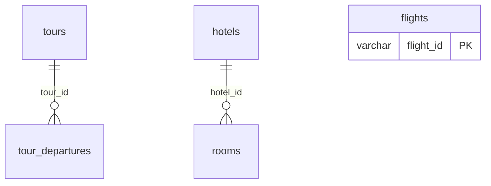
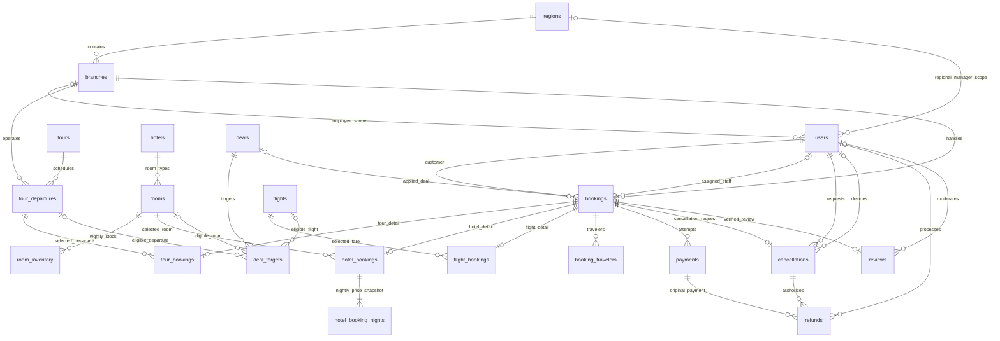

# SàiHành — Báo cáo database giai đoạn 1

Ngày lập: 19/10/2026 (Asia/Bangkok). Trạng thái: **đề xuất chờ duyệt; chưa viết SQL triển khai**.

## 1. Phạm vi và bằng chứng

- Đã đọc toàn bộ `database/`: chỉ có `travelhub_columns.csv`, không có SQL dump/DDL. Đã tìm file `.sql` trong repository, không tìm thấy.
- Đã đọc toàn bộ model, repository, cấu hình kết nối, khởi tạo ứng dụng, endpoint, middleware và README của backend ASP.NET Core. Không thay đổi backend/frontend.
- Đã kết nối Aiven bằng cấu hình hiện có, giữ TLS `VerifyFull`, không in hoặc lưu thông tin xác thực vào báo cáo. Lần thử trong sandbox lỗi 1042/AuthenticationException; lần chạy ngoài sandbox được cho phép đã thành công.
- Máy chủ trả về **MySQL 8.0.45**, database **travelhub_demo**. Thời điểm metadata: **2026-10-19 10:17:57 UTC / 17:17:57 Asia/Bangkok**.
- Chỉ thực hiện các truy vấn đọc: phiên bản/database/thời gian, `INFORMATION_SCHEMA.TABLES`, `COLUMNS`, `TABLE_CONSTRAINTS`, `KEY_COLUMN_USAGE`, `REFERENTIAL_CONSTRAINTS`, `STATISTICS`, `CHECK_CONSTRAINTS`, `TRIGGERS` và `COUNT(*)` từng bảng.
- Không chạy DDL, DML hay migration; không thay đổi cấu hình, User Secrets hoặc Aiven. Công cụ kiểm tra tạm nằm trong thư mục TEMP, không sửa mã ứng dụng. Tệp bàn giao trong repo là báo cáo này.
- Các kết quả schema bên dưới đã được xác minh trực tiếp, khớp CSV 5 bảng/51 cột. Số đếm là chính xác tại lúc từng truy vấn chạy, không phải snapshot giao dịch đồng thời; `TABLE_ROWS` của InnoDB chỉ là ước lượng và không được dùng làm số đếm.
- Không đọc nội dung khách hàng hoặc dữ liệu nghiệp vụ từng dòng; chưa kiểm tra tỷ lệ NULL, giá âm, lịch lỗi, định dạng chuỗi hoặc tính đúng đắn của dữ liệu demo. Tên cột có chữ `demo` không tự chứng minh mọi dòng là dữ liệu giả.

## 2. Hiện trạng đã xác minh

| Bảng | Số cột | COUNT(*) | Primary Key | Engine / collation |
|---|---:|---:|---|---|
| tours | 13 | 50 | tour_id | InnoDB / utf8mb4_unicode_ci |
| tour_departures | 6 | 200 | departure_id | InnoDB / utf8mb4_unicode_ci |
| hotels | 9 | 100 | hotel_id | InnoDB / utf8mb4_unicode_ci |
| rooms | 7 | 300 | room_id | InnoDB / utf8mb4_unicode_ci |
| flights | 16 | 200 | flight_id | InnoDB / utf8mb4_unicode_ci |
| **Tổng** | **51** | **850** | | |

### 2.1. Từ điển cột hiện tại

`NULL` bên dưới là khả năng nhận NULL. Tất cả cột có `COLUMN_DEFAULT = NULL` trong metadata; với cột NOT NULL, điều đó không có nghĩa cho phép ghi NULL. Không có AUTO_INCREMENT, generated column hay EXTRA. Tất cả cột ký tự dùng `utf8mb4_unicode_ci`.

#### tours

| Cột | Kiểu MySQL | NULL | Khóa |
|---|---|---|---|
| tour_id | varchar(12) | NO | PK |
| ten_tour | varchar(255) | YES | — |
| diem_khoi_hanh | varchar(100) | YES | — |
| diem_den | varchar(100) | YES | — |
| so_ngay | int | YES | — |
| so_dem | int | YES | — |
| phuong_tien | varchar(30) | YES | — |
| gia_nguoi_lon_vnd | bigint | YES | — |
| gia_tre_em_vnd | bigint | YES | — |
| diem_tham_quan | text | YES | — |
| lich_trinh_tom_tat | text | YES | — |
| loai_du_lieu | varchar(80) | YES | — |
| nguon_tham_khao | text | YES | — |

#### tour_departures

| Cột | Kiểu MySQL | NULL | Khóa |
|---|---|---|---|
| departure_id | varchar(12) | NO | PK |
| tour_id | varchar(12) | NO | FK; index không unique |
| ngay_khoi_hanh | date | YES | — |
| so_cho_con | int | YES | — |
| gia_nguoi_lon_vnd | bigint | YES | — |
| trang_thai | varchar(80) | YES | — |

#### hotels

| Cột | Kiểu MySQL | NULL | Khóa |
|---|---|---|---|
| hotel_id | varchar(12) | NO | PK |
| ten_khach_san | varchar(255) | YES | — |
| thanh_pho | varchar(100) | YES | — |
| dia_chi | varchar(255) | YES | — |
| hang_sao_demo | int | YES | — |
| gia_tu_vnd_dem | bigint | YES | — |
| tien_nghi | text | YES | — |
| ghi_chu | text | YES | — |
| nguon_tham_khao | text | YES | — |

#### rooms

| Cột | Kiểu MySQL | NULL | Khóa |
|---|---|---|---|
| room_id | varchar(12) | NO | PK |
| hotel_id | varchar(12) | NO | FK; index không unique |
| loai_phong | varchar(80) | YES | — |
| suc_chua | int | YES | — |
| gia_vnd_dem | bigint | YES | — |
| so_phong_con | int | YES | — |
| loai_du_lieu | varchar(80) | YES | — |

#### flights

| Cột | Kiểu MySQL | NULL | Khóa |
|---|---|---|---|
| flight_id | varchar(12) | NO | PK |
| so_hieu_demo | varchar(30) | YES | — |
| hang_bay_tham_khao | varchar(100) | YES | — |
| ma_san_bay_di | char(3) | YES | — |
| noi_di | varchar(100) | YES | — |
| ma_san_bay_den | char(3) | YES | — |
| noi_den | varchar(100) | YES | — |
| ngay_bay | date | YES | — |
| gio_di | time | YES | — |
| gio_den | time | YES | — |
| thoi_gian_phut | int | YES | — |
| hang_ve | varchar(50) | YES | — |
| gia_vnd | bigint | YES | — |
| so_ghe_con | int | YES | — |
| ghi_chu | text | YES | — |
| nguon_tham_khao | text | YES | — |

### 2.2. Foreign Key và quan hệ

| Constraint | Bảng con/cột | Bảng cha/cột | ON UPDATE | ON DELETE |
|---|---|---|---|---|
| rooms_ibfk_1 | rooms.hotel_id | hotels.hotel_id | NO ACTION | NO ACTION |
| tour_departures_ibfk_1 | tour_departures.tour_id | tours.tour_id | NO ACTION | NO ACTION |

Một hotel có 0..N rooms, mỗi room bắt buộc thuộc đúng một hotel. Một tour có 0..N departures, mỗi departure bắt buộc thuộc đúng một tour. Không có FK khác. `flights` độc lập. Không có quan hệ tour–hotel hay tour–flight được lưu trong schema hiện tại.

### 2.3. Index và ràng buộc

| Bảng | Index | Cột, theo thứ tự | Unique | Loại |
|---|---|---|---|---|
| tours | PRIMARY | tour_id | Có | BTREE |
| tour_departures | PRIMARY | departure_id | Có | BTREE |
| tour_departures | tour_id | tour_id | Không | BTREE |
| hotels | PRIMARY | hotel_id | Có | BTREE |
| rooms | PRIMARY | room_id | Có | BTREE |
| rooms | hotel_id | hotel_id | Không | BTREE |
| flights | PRIMARY | flight_id | Có | BTREE |

Tất cả index visible, toàn bộ cột (không prefix), không expression index. Tổng 5 PK + 2 FK + 2 index FK không unique. Không có UNIQUE constraint ngoài PK; không có CHECK constraint hoặc trigger trong metadata nhìn thấy bởi tài khoản kết nối. Các số lượng, giá, hạng sao, thời lượng và trạng thái chưa được CHECK bảo vệ. Ngoài PK và hai cột FK, mọi cột đều nullable. Index FK có ích khi lấy phòng theo khách sạn và lịch theo tour; chưa có index phục vụ lọc tuyến/ngày bay, điểm đến hoặc khoảng giá.

### 2.4. Backend/API hiện tại

Nguồn: `backend/Models/TravelModels.cs`, `Data/TravelRepository.cs`, `Data/MySqlConnectionFactory.cs`, `Api/TravelEndpoints.cs`, `Program.cs`.

| Endpoint GET | Nguồn | Hành vi |
|---|---|---|
| /api/tours | tours | Danh sách, sắp theo tour_id |
| /api/tours/{id} | tours + tour_departures | Chi tiết + lịch theo ngày/id |
| /api/hotels | hotels | Danh sách theo hotel_id |
| /api/hotels/{id} | hotels + rooms | Chi tiết + loại phòng theo room_id |
| /api/flights | flights | Danh sách theo ngày/giờ/id |
| /api/health/database | SELECT 1 | Chỉ kiểm tra kết nối |

Repository dùng MySqlConnector và SELECT tường minh, không EF/migration. API ID tối đa 12 ký tự; ID là chuỗi, không chuyển sang số. JSON camelCase, `BIGINT` sang C# `long`, ngày sang `DateOnly`, giờ sang `TimeSpan`. Không có endpoint ghi, đăng nhập hoặc middleware xác thực/phân quyền. Danh sách chưa phân trang/tìm kiếm. CORS giới hạn GET không thay thế phân quyền. Connection factory hiện cố định tên database `travelhub_demo`.

API local tại cổng 5108 không hoạt động khi thăm dò. Kết luận schema/số đếm đến từ kết nối MySQL trực tiếp, không phải phản hồi API hoặc ghi nhận test cũ trong README.

## 3. Mức đáp ứng nghiệp vụ và thiếu hụt

| Nghiệp vụ | Đáp ứng hiện tại | Còn thiếu |
|---|---|---|
| Công ty → khu vực → chi nhánh | Chưa có bảng | Cơ cấu và phạm vi quản lý; chi nhánh xử lý đơn |
| Tour | Danh mục, mô tả/tóm tắt, giá tham khảo | Chủ thể vận hành, trạng thái bán, lịch trình theo ngày nếu cần |
| Lịch tour | Ngày, số chỗ còn, giá người lớn, trạng thái chuỗi | Sức chứa gốc, giờ/ngày kết thúc, giá trẻ em theo lịch, giữ chỗ có hạn |
| Khách sạn/phòng | Danh mục và loại phòng có giá/số lượng chung | Tồn và giá theo từng đêm, đặt phòng theo khoảng lưu trú |
| Máy bay | Danh mục tuyến/ngày/hạng vé, giá và ghế | Thời điểm đến có ngày/múi giờ, vé/hành khách, giữ ghế, xác nhận đặt vé |
| Đơn dịch vụ | Không có | Chủ đơn, khách sử dụng, chi tiết, giá chốt, trạng thái và chi nhánh |
| Khách hàng/nhân viên | Không có | Tài khoản, hồ sơ và phân công công việc |
| 5 vai trò | Không có | Vai trò cùng phạm vi khu vực/chi nhánh và kiểm tra quyền trên server |
| Thanh toán/hủy/hoàn | Không có | Giao dịch, chống xử lý trùng, phê duyệt, phí và tiền hoàn |
| Săn Deal | Không có | Chương trình, đối tượng áp dụng, thời hạn, hạn mức, giá trị giảm |
| Đánh giá | Không có | Gắn dịch vụ đã sử dụng, tác giả, điểm, kiểm duyệt |

Các cột `so_cho_con`, `so_phong_con`, `so_ghe_con` là số tổng hiện tại, chưa có bằng chứng về cơ chế giữ chỗ hay chống bán vượt. `rooms` có trường loại phòng và số phòng còn nên **đề xuất** hiểu là loại phòng, cần chủ đồ án xác nhận. `flights` đang gộp chuyến bay và một hạng vé; chưa thể kết luận cách dữ liệu thực tế phân biệt chúng. Chuỗi tiện nghi/điểm tham quan vẫn phù hợp mô tả, chỉ tách bảng khi cần lọc/quản lý từng mục.

## 4. Quyết định thiết kế đề xuất

Đây là mô hình mục tiêu, **không phải các bảng đã tồn tại**. Ưu tiên mở rộng 5 bảng cũ, giữ ID và hợp đồng GET hiện có. Một công ty duy nhất là SàiHành: thông tin pháp nhân có thể là cấu hình, không cần bảng companies khi chưa có đa công ty.

1. Một khu vực có nhiều chi nhánh; một chi nhánh thuộc một khu vực. Danh mục dịch vụ dùng chung toàn công ty. Lịch tour có chi nhánh vận hành; đơn có chi nhánh bán/xử lý, hai vai trò này có thể khác nhau.
2. Một đơn chỉ đặt **một loại dịch vụ và một lựa chọn bán**: một lịch tour, một loại phòng/khoảng lưu trú, hoặc một lựa chọn chuyến bay/hạng vé. Cho phép nhiều khách hoặc nhiều phòng trong cùng đơn. Chưa làm giỏ hàng trộn tour–hotel–flight. Cách này tránh order_items và mô hình tham chiếu đa hình thiếu FK; nếu muốn giỏ hỗn hợp phải đổi thiết kế trước SQL.
3. `bookings` là phần chung; ba bảng chi tiết 1:0..1 có PK đồng thời là FK booking_id. Đơn đã hoàn tất khởi tạo bắt buộc có đúng một chi tiết đúng loại. CHECK trong một bảng không kiểm tra được sự tồn tại ở bảng khác: backend sau này phải tạo nguyên tử và kiểm tra bất biến này.
4. VND duy nhất, số tiền nguyên `BIGINT` không âm. Giá chốt lưu ở đơn/chi tiết; thay đổi giá danh mục không đổi đơn cũ. Không dùng FLOAT. Thời điểm hệ thống lưu UTC bằng DATETIME(6); đêm khách sạn dùng DATE địa phương. Chuyến bay có đầy đủ ngày giờ UTC và múi giờ IANA tại nơi đi/đến.
5. Không xóa cứng dịch vụ đã có giao dịch. Dùng trạng thái hoạt động/ẩn, FK lịch sử RESTRICT/NO ACTION; không cascade xóa đơn và thanh toán.
6. Phân quyền cố định 5 vai trò bằng mã trong bảng users và phạm vi FK; không tạo bộ bảng permissions/role_permissions khi chưa có quyền tùy biến hoặc người dùng đa vai trò.
7. Hủy toàn bộ đơn và hoàn nhiều lần trong giới hạn đã thu; chưa hủy một vài hành khách/đêm. Thanh toán đủ một lần hoặc nhiều lần thử; thiết kế lưu được nhiều giao dịch, nhưng chính sách cọc cần chốt.
8. Săn Deal là chương trình giảm giá trực tiếp cho một lựa chọn bán, mỗi đơn tối đa một deal, không cộng dồn. Chưa làm voucher cá nhân, đấu giá hoặc điểm thưởng.

## 5. Các bảng mục tiêu và khóa

Quy ước: các trường `*_id` bên dưới là FK trừ PK được chỉ rõ; `?` cho phép NULL. ID danh mục cũ giữ VARCHAR(12); PK mới đề xuất BIGINT UNSIGNED, FK cùng kiểu PK. Tên/trường mới là dự kiến để duyệt nghiệp vụ, chưa phải đặc tả DDL cuối cùng. Các bảng thay đổi theo thời gian có created_at/updated_at; giao dịch có thời điểm trạng thái và lưu bất biến sau thành công.

### 5.1. Tổ chức và con người — 3 bảng mới

| Bảng | Khóa và trường chính đề xuất | Ý nghĩa |
|---|---|---|
| regions | region_id PK; code VARCHAR(30) UNIQUE; name VARCHAR(120); is_active | Khu vực quản lý, không đồng nhất với điểm đến du lịch |
| branches | branch_id PK; region_id NOT NULL; code VARCHAR(30) UNIQUE; name VARCHAR(150); address VARCHAR(255); is_active | Một khu vực – nhiều chi nhánh |
| users | user_id PK; email VARCHAR(254) UNIQUE đã chuẩn hóa; password_hash VARCHAR(255); full_name VARCHAR(150); phone VARCHAR(30)?; role_code VARCHAR(30); region_id?; branch_id?; employee_code VARCHAR(30)? UNIQUE; is_active | Tài khoản cùng hồ sơ tối thiểu khách hàng/nhân viên, không tách bảng hồ sơ trùng lặp |

| Vai trò | region_id | branch_id | Phạm vi đề xuất |
|---|---|---|---|
| SUPER_ADMIN | NULL | NULL | Toàn công ty, quản lý tổ chức/tài khoản/danh mục |
| REGIONAL_MANAGER | Bắt buộc | NULL | Các chi nhánh thuộc khu vực; báo cáo, duyệt trong hạn mức |
| BRANCH_MANAGER | NULL | Bắt buộc | Nhân viên, đơn và vận hành thuộc chi nhánh |
| STAFF | NULL | Bắt buộc | Tạo/xử lý đơn chi nhánh; không tự cấp quyền/duyệt hoàn |
| CUSTOMER | NULL | NULL | Hồ sơ và đơn của chính mình; đánh giá dịch vụ đã sử dụng |

CHECK kiểm soát tổ hợp vai trò/phạm vi và mã vai trò. Phạm vi khu vực của quản lý chi nhánh suy ra qua branches, không lưu lặp trên users. Backend phải kiểm tra cả vai trò, chủ sở hữu và phạm vi dữ liệu cho từng yêu cầu. `assigned_staff_id` phải là nhân viên hợp lệ thuộc chi nhánh đơn; FK đơn thuần tới users không đảm bảo điều này. Quyền quản lý tổ chức/tài khoản chỉ Super Admin; quyền sửa danh mục chung ban đầu chỉ Super Admin, quyền điều hành lịch theo chi nhánh. Quyền duyệt tài chính chi tiết cần xác nhận.

Chưa hỗ trợ một người đồng thời là Staff và Customer hoặc quản lý nhiều khu vực. Nếu yêu cầu này có thật, thay role_code/phạm vi trực tiếp bằng bảng phân công có scope; không thêm mặc định.

### 5.2. Danh mục và tồn — giữ 5 bảng, thêm 1 bảng

| Bảng | Thay đổi mục tiêu | Quan hệ/chú ý |
|---|---|---|
| tours | Giữ toàn bộ ID/cột phục vụ GET; thêm trạng thái bán, thời điểm tạo/sửa; giá hiện tại là giá tham khảo | Một tour – nhiều lịch. Chưa cần bảng hành trình nếu chỉ mô tả |
| tour_departures | Thêm operating_branch_id, capacity INT, ends_at; giá trẻ em theo lịch; chuẩn hóa trạng thái OPEN/CLOSED/DEPARTED/CANCELLED | Mỗi lịch có một tour, một chi nhánh vận hành. Không gán chi nhánh mặc định cho demo khi chưa xác nhận |
| hotels | Giữ cột cũ; thêm trạng thái bán, múi giờ khách sạn | Không gán khách sạn là chi nhánh công ty. Hạng sao demo phải được rà soát |
| rooms | Giữ tên bảng và room_id; định nghĩa là loại phòng; thêm tổng số phòng vật lý/quota theo hợp đồng và trạng thái | Mỗi loại thuộc đúng một hotel; không quản lý số phòng vật lý riêng ở giai đoạn đầu |
| room_inventory | PK (room_id, stay_date DATE); capacity INT; nightly_price_vnd BIGINT; is_closed | Một dòng cho mỗi loại phòng/đêm. Ngày chưa có inventory không được suy ra là còn phòng |
| flights | Giữ flight_id; coi mỗi dòng là một lựa chọn chuyến bay/hạng vé; thêm capacity, departs_at_utc, arrives_at_utc, departure_timezone, arrival_timezone, trạng thái; booking_reference nằm ở đơn vé | Một lựa chọn – nhiều đơn. Nhiều hạng vé có thể lặp thông tin chuyến; chấp nhận cho đồ án, chỉ tách flights/flight_fares khi cần quản lý chuyến độc lập |

`capacity`/inventory là nguồn sức chứa, đơn HOLD chưa hết hạn và đơn CONFIRMED/COMPLETED tiêu thụ tồn; đơn hết hạn/hủy không tiêu thụ tồn. Không lấy hai nguồn tổng còn và đặt chỗ làm nguồn sự thật song song. Các cột còn chỗ cũ chỉ là giá trị tương thích đọc, cần cơ chế tính/mapping trong giai đoạn sau; chưa đổi bây giờ. Với khách sạn, API không có ngày chỉ hiển thị giá tham khảo, không cam kết tồn.

Khi đặt, cần giao dịch khóa hàng lịch tour/chuyến bay hoặc từng hàng room_inventory theo thứ tự ngày cố định, đếm lại tồn và giữ chỗ. Phải kiểm tra đủ tất cả đêm [check_in, check_out); khi hết hạn giải phóng về mặt logic và xử lý trường hợp thanh toán đến trễ. Đây là yêu cầu triển khai sau duyệt, không có mã giao dịch nào được chạy trong giai đoạn này.

### 5.3. Đặt dịch vụ — 6 bảng mới

| Bảng | Khóa và trường chính đề xuất | Quy tắc |
|---|---|---|
| bookings | booking_id PK; booking_code VARCHAR(30) UNIQUE; customer_id → users; branch_id; assigned_staff_id? → users; service_type VARCHAR(10); status VARCHAR(20); contact_name/email/phone; subtotal_vnd, discount_vnd, total_vnd BIGINT; deal_id?; deal_rule_snapshot JSON?; cancellation_policy_snapshot TEXT; hold_expires_at?; created_at | Chủ đơn khác người đi; chi nhánh xử lý bắt buộc, đơn online cần quy tắc phân tuyến. Giá/điều khoản là bản chốt |
| tour_bookings | booking_id PK/FK; departure_id; adult_count INT; child_count INT; adult_unit_price_vnd, child_unit_price_vnd BIGINT | Tổng người > 0; xác nhận quy tắc trẻ em/ghế |
| hotel_bookings | booking_id PK/FK; room_id; check_in DATE; check_out DATE; room_count INT; guest_count INT | Một loại phòng, một khoảng lưu trú; check_out > check_in |
| hotel_booking_nights | PK (booking_id, stay_date); booking_id → hotel_bookings; unit_price_vnd BIGINT | Bản chốt giá từng đêm, cần vì inventory có thể đổi; số đêm khớp khoảng lưu trú |
| flight_bookings | booking_id PK/FK; flight_id; passenger_count INT; unit_price_vnd BIGINT; provider_booking_reference VARCHAR(100)?; ticket_status VARCHAR(20) | Giả định một chặng, một hạng, một đơn giá; giá trẻ em/em bé khác nhau cần mở rộng trước SQL |
| booking_travelers | traveler_id PK; booking_id; full_name VARCHAR(150); birth_date DATE?; traveler_type VARCHAR(10); document_number VARCHAR(100)?; ticket_number VARCHAR(100)? | Danh sách người đi của tour/vé, khách lưu trú nếu cần. Không dùng hồ sơ users làm hành khách duy nhất |

Snapshot giá là sự lặp có chủ đích để bảo toàn lịch sử. Tổng phòng bằng room_count × tổng đơn giá đêm; tổng tour bằng số người × đơn giá từng nhóm; tổng vé theo giả định đơn giá chung. `total = subtotal - discount`, giảm không vượt subtotal; chưa có phụ phí/thuế tách riêng, nếu có phải chốt quy tắc. Đếm hành khách, giới hạn sức chứa và tổng đêm cần kiểm tra trong giao dịch backend vì CHECK không tổng hợp bảng con.

### 5.4. Thanh toán, hủy và hoàn — 3 bảng mới

| Bảng | Khóa và trường chính đề xuất | Ý nghĩa |
|---|---|---|
| payments | payment_id PK; booking_id; method VARCHAR(30); provider VARCHAR(30); idempotency_key VARCHAR(100) UNIQUE; provider_transaction_id VARCHAR(150)?; amount_vnd BIGINT; status VARCHAR(20); paid_at? | Một đơn có nhiều lần thử/thu tiền; UNIQUE(provider, provider_transaction_id) khi có mã nhà cung cấp; không lưu số thẻ/CVV |
| cancellations | cancellation_id PK; booking_id UNIQUE; requested_by → users; reason TEXT; status VARCHAR(20); decided_by? → users; requested_at; decided_at?; fee_vnd BIGINT; approved_refund_vnd BIGINT; policy_snapshot TEXT | Một yêu cầu hủy toàn đơn, cho phép cập nhật/gửi lại yêu cầu bị từ chối theo chính sách; người yêu cầu và người duyệt được lưu riêng |
| refunds | refund_id PK; cancellation_id; payment_id; idempotency_key VARCHAR(100) UNIQUE; provider_refund_id VARCHAR(150)?; amount_vnd BIGINT; status VARCHAR(20); processed_by? → users; completed_at? | Một thanh toán có nhiều hoàn; UNIQUE(provider_refund_id) trong phạm vi nhà cung cấp tương ứng khi triển khai |

Refund phải tham chiếu payment thuộc cùng booking với cancellation. FK riêng lẻ không đảm bảo điều này; kiểm tra nguyên tử tại backend hoặc thiết kế khóa ghép khi chốt DDL. Tổng hoàn thành công + các lệnh hoàn đang giữ hạn mức không vượt tiền thu thành công, và không vượt approved_refund_vnd. Khi retry, tái sử dụng idempotency key cho cùng thao tác, không tạo yêu cầu tiền mới vô tình.

Webhook chỉ được cập nhật sau xác minh chữ ký, đối soát mã/tiền/đơn; xử lý trùng phải an toàn. Không đánh dấu đã thanh toán dựa trên redirect từ trình duyệt. Trạng thái đơn và trạng thái thanh toán/hoàn là các khái niệm riêng; không thêm cột payment_status lưu lặp thiếu cơ chế đồng bộ.

Luồng đề xuất: booking HOLD → CONFIRMED → COMPLETED; HOLD → EXPIRED; HOLD/CONFIRMED → CANCELLED theo chính sách. Yêu cầu hủy PENDING → APPROVED/REJECTED; chỉ APPROVED mới chuyển đơn sang CANCELLED và trả tồn. Payment PENDING → SUCCEEDED/FAILED; refund PENDING → SUCCEEDED/FAILED. Tiền đến sau EXPIRED hoặc CANCELLED phải đi đối soát/hoàn, không tự giành lại chỗ đã bán.

### 5.5. Săn Deal và đánh giá — 3 bảng mới

| Bảng | Khóa và trường chính đề xuất | Quy tắc |
|---|---|---|
| deals | deal_id PK; code VARCHAR(40) UNIQUE; name VARCHAR(150); starts_at, ends_at; discount_type VARCHAR(10); discount_value BIGINT; max_discount_vnd BIGINT?; usage_limit INT?; status VARCHAR(20) | PERCENT 1..100 hoặc FIXED > 0; thời gian UTC; chưa cộng dồn |
| deal_targets | target_id PK; deal_id; departure_id?; room_id?; flight_id?; stay_from DATE?; stay_to DATE? | Đúng một FK dịch vụ khác NULL, không dùng target_type/target_id thiếu FK. Với khách sạn phải xác định khoảng đêm áp dụng. UNIQUE cho mỗi cặp deal và mục tiêu |
| reviews | review_id PK; booking_id UNIQUE; rating TINYINT; content TEXT; moderation_status VARCHAR(20); moderated_by? → users; moderated_at?; created_at, updated_at | Một đánh giá/đơn COMPLETED, chỉ chủ đơn được tạo; rating 1..5. Tác giả và mục tiêu suy ra từ booking, không lưu lặp customer_id/product_id |

Đánh giá khách sạn quy về hotel qua room, tour quy về tour qua departure, vé quy về lựa chọn flight. Chưa có bình luận, ảnh, phản hồi doanh nghiệp hoặc nhiều đánh giá/đơn. Hạn mức deal tính cả HOLD còn hạn để tránh vượt quota; xử lý trong giao dịch khóa deal. Cần chốt đơn hủy có trả quota và giới hạn mỗi khách. Không thêm deal_redemptions vì bookings đã lưu deal_id và trạng thái đủ cho mô hình này.

Tổng mục tiêu: **21 bảng = 5 bảng hiện hữu mở rộng + 16 bảng mới**. Mỗi bảng mới phục vụ quan hệ hoặc lịch sử không thể bỏ mà vẫn giữ các giả định trên. Không thêm bảng công ty, phân quyền tùy biến, nhà cung cấp, sân bay, tiện nghi, media, audit log tổng quát hay giỏ hàng khi chưa có nghiệp vụ cụ thể.

## 6. ERD mục tiêu

Các đường FK đa lựa chọn ở deal_targets đều tùy chọn; quy tắc đúng một đích nằm trong CHECK. Các bảng chi tiết bookings cũng cần quy tắc đúng một loại như mục 4. Các mũi tên users có nhiều vai trò được chú thích để tránh hiểu mọi quan hệ đều là chủ đơn.

## 7. Ràng buộc/index mục tiêu và tích hợp

- FK thực cho mọi tham chiếu; PK/FK cùng kiểu/collation. Không có ID dịch vụ đa hình chung trong bookings. Các tham chiếu bắt buộc NOT NULL sau khi dữ liệu demo đã được rà soát/bổ sung có phê duyệt.
- CHECK giá/số lượng không âm; capacity > 0 khi mở bán; số người/phòng > 0; hạng sao trong miền được duyệt; ngày/giờ kết thúc sau bắt đầu; discount không vượt subtotal; mã trạng thái thuộc tập cho phép. CHECK không thay thế quyền truy cập hoặc giao dịch chống cạnh tranh.
- Bảo vệ tổ hợp role/scope, một đích deal và các giá trị giảm; FK lịch sử mặc định RESTRICT/NO ACTION. Không dùng cascade xóa tài chính.
- Index dự kiến theo truy vấn: branches(region_id); users(branch_id, role_code); tour_departures(tour_id, ngay_khoi_hanh), (operating_branch_id, ngay_khoi_hanh); flights(ma_san_bay_di, ma_san_bay_den, departs_at_utc); hotels(thanh_pho); rooms(hotel_id).
- bookings(customer_id, created_at), (branch_id, status, created_at), (status, hold_expires_at); các detail có index FK dịch vụ để đếm tồn; payments(booking_id, status), refunds(payment_id, status), deal_targets theo FK, reviews(moderation_status, created_at). room_inventory dùng PK(room_id, stay_date). Cần xem EXPLAIN/truy vấn thực trước quyết định thêm index, không tạo index đơn bị trùng tiền tố index ghép/FK.
- Giữ nguyên tên và kiểu ID 5 bảng cũ để API hiện tại không gãy. Giá/NULL/chuyển đổi thời gian trên DTO cũ phải được kiểm thử ở giai đoạn triển khai. Không đổi tên `rooms` thành `room_types` ngay chỉ vì tên rõ hơn.
- Trạng thái mới dùng mã ổn định, không dùng văn bản giao diện làm logic. Không siết NOT NULL/CHECK cho dữ liệu đang có trước khi rà soát. Không tự suy diễn chuỗi trạng thái cũ hoặc phân bổ chi nhánh từ điểm đến.
- Nhận xét frontend chỉ dựa trên hợp đồng backend hiện có; không phát triển hoặc sửa frontend trong phiên này. Các API đặt, xác thực, phân quyền, thanh toán sẽ là công việc riêng sau duyệt.

## 8. Phân loại các bảng/cấu trúc

| Nhóm | Bảng/cấu trúc | Quyết định đề xuất |
|---|---|---|
| Giữ nền tảng | tours, tour_departures, hotels, rooms, flights; PK; 2 FK | Giữ toàn bộ dữ liệu, ID và quan hệ gốc; không có bảng hiện tại cần bỏ toàn bộ |
| Cần mở rộng | Cả 5 bảng trên | Bổ sung vòng đời bán, tổ chức vận hành, sức chứa/thời gian/giá theo nghiệp vụ |
| Còn thiếu | regions, branches, users, room_inventory, bookings, tour_bookings, hotel_bookings, hotel_booking_nights, flight_bookings, booking_travelers, payments, cancellations, refunds, deals, deal_targets, reviews | Chỉ là đề xuất, chưa tồn tại trên máy chủ |
| Không phù hợp để dùng làm nguồn vận hành duy nhất | so_phong_con không có ngày, giá hotel chung, giờ đến flight thiếu ngày, số còn chỗ không có lịch sử giữ chỗ | Giữ khả năng tương thích đọc, thay nguồn tính bằng mô hình mục tiêu khi triển khai |
| Cần rà soát ý nghĩa | so_hieu_demo, hang_sao_demo, loai_du_lieu, nguon_tham_khao; chuỗi trạng thái, tiện nghi/lịch trình | Giữ dữ liệu demo và xuất xứ; không coi là dữ liệu vận hành đã kiểm định |
| Cần tăng bảo vệ | Hầu hết cột nullable; không CHECK; không tài khoản/quyền | Rà soát rồi mới bổ sung ràng buộc và kiểm soát truy cập |

Nhóm giữ và mở rộng chồng nhau có chủ đích: giữ bảng không có nghĩa giữ nguyên mọi giới hạn hiện tại.

## 9. Nâng cấp database hay tạo mới?

| Phương án | Ưu điểm | Nhược điểm / điều kiện |
|---|---|---|
| Nâng cấp travelhub_demo theo từng bước | Giữ 850 bản ghi, ID và kết nối backend; ít mapping; không phải chuyển frontend/API; phù hợp đồ án đơn công ty | Phải kiểm định và backfill trước siết ràng buộc; cần kế hoạch khôi phục; tên demo và cấu trúc cũ còn tồn tại; DDL sau này ảnh hưởng database đang dùng |
| Tạo database mới (tên chờ duyệt) | Có môi trường dựng và kiểm thử riêng; giữ nguyên demo để đối chiếu; thiết kế sạch và thử chuyển dữ liệu trước cutover | Thêm công quản lý/copy/đối soát; dễ lệch dữ liệu; backend đang chặn database khác nên cần thay mã và cấu hình ở giai đoạn được phép; không tự có dữ liệu/ID tương thích |

**Khuyến nghị: nâng cấp có kiểm soát travelhub_demo**, giữ 5 bảng và dữ liệu hiện tại, bổ sung mô hình giao dịch sau khi chốt nghiệp vụ. Quy mô nhỏ và backend chủ yếu đọc danh mục nên lợi ích tương thích cao. Khuyến nghị này không phải cho phép thay đổi ngay. Trước triển khai cần bản sao lưu đã xác minh khôi phục, kiểm tra chất lượng dữ liệu, kế hoạch nâng cấp theo bước và kiểm thử trong môi trường riêng nếu có. Việc tạo bản sao/database thử nghiệm cũng cần bạn duyệt, chưa thực hiện trong giai đoạn 1.

Nên chọn database mới nếu bạn muốn demo hiện tại bất biến lâu dài, cần đổi mạnh mô hình giỏ hàng/đa vai trò/nhà cung cấp, hoặc có môi trường thử nghiệm độc lập được cấp phép. Không tạo database, không chuyển kết nối trong phiên này.

## 10. Các quyết định cần chủ đồ án xác nhận

| # | Cần xác nhận | Mặc định đề xuất trong ERD | Tác động nếu khác |
|---|---|---|---|
| 1 | Nâng cấp hay database mới? | Nâng cấp travelhub_demo, giữ demo | Đổi kế hoạch chuyển dữ liệu và tích hợp nếu tạo mới |
| 2 | Đơn đơn dịch vụ hay giỏ hỗn hợp? | Một đơn/một lựa chọn dịch vụ | Giỏ hỗn hợp cần order_items, hủy/giá theo dòng |
| 3 | Khu vực/chi nhánh thực tế; ai xử lý đơn online; có chuyển chi nhánh? | Một chi nhánh xử lý/đơn, một chi nhánh vận hành/lịch | Cần danh sách và quy tắc phân tuyến; không tự gán dữ liệu demo |
| 4 | Một tài khoản có đa vai trò/đa phạm vi, nhân viên có đặt cá nhân không? | Một vai trò, một phạm vi | Nếu có cần bảng phân công quyền thay cột trực tiếp |
| 5 | Có đặt không đăng nhập? | Customer có tài khoản | Guest booking cần customer_id nullable và xác minh quyền tra cứu |
| 6 | rooms là loại phòng hay phòng vật lý? Ai cấp quota, giá theo đêm thế nào? | Loại phòng; inventory từng đêm | Quản lý phòng vật lý cần cấu trúc khác; phải xác nhận trước backfill |
| 7 | Vé demo hay kết nối hãng; nhiều chặng/khứ hồi, nhiều hạng, giá trẻ em/em bé? | Một chặng, một hạng, một đơn giá/đơn | Cần fare/segment/ticket và giá theo hành khách nếu có |
| 8 | Tuổi trẻ em/em bé, giá theo lịch, ai chiếm ghế? | Người lớn/trẻ em, đều chiếm chỗ; giá chốt theo lịch | Tác động sức chứa và mô hình hành khách |
| 9 | Thanh toán đủ/cọc, cổng nào, tiền tệ/phí/thuế? | VND, đủ tiền, chưa tách thuế/phí | Bổ sung chính sách cọc/lịch thu hoặc thành phần giá |
| 10 | Giữ chỗ bao lâu; payment đến trễ xử lý ai? | Có hold_expires_at; thời lượng chưa chốt | Không tự chọn số phút; cần quy trình đối soát |
| 11 | Hủy toàn bộ/một phần, hạn/phí hủy, cấp duyệt và hạn mức hoàn? | Hủy toàn bộ, nhiều lần hoàn có kiểm soát | Hủy từng người/đêm cần dòng yêu cầu và phân bổ tiền |
| 12 | Deal theo lịch/loại phòng/chuyến, quota, mỗi khách, cộng dồn, trả quota khi hủy? | Một deal/đơn, không cộng dồn, mục tiêu cụ thể | Cần chốt cách tính giá và giữ hạn mức |
| 13 | Đánh giá khi nào, có kiểm duyệt/ảnh/phản hồi? | Một review/đơn COMPLETED, có trạng thái duyệt | Có thể thêm bảng nếu thực sự cần nội dung phụ |
| 14 | Danh mục bán chung, quyền quản lý lịch/giá và tồn? | Danh mục toàn công ty; lịch có chi nhánh vận hành | Cần bảng phân phối dịch vụ nếu quota/giá riêng từng chi nhánh |
| 15 | Lịch tour chi tiết, ảnh, tiện nghi cần lọc hay chỉ mô tả? | Giữ text và hợp đồng hiện tại | Chỉ bổ sung bảng lịch trình/media/tiện nghi khi xác nhận |

## 11. Điều kiện chuyển sang giai đoạn SQL

Chờ duyệt phương án database và các giả định ảnh hưởng cấu trúc ở mục 10. Sau duyệt mới lập đặc tả cột/khóa/trạng thái cuối cùng, kế hoạch kiểm định/backfill/khôi phục và viết SQL để bạn xem xét. **Giai đoạn 1 kết thúc tại báo cáo; chưa tạo SQL triển khai, chưa sửa ứng dụng hoặc dữ liệu.**
